# DFIR Lab: Web Shell and RAT Compromise of an IIS Server via Writable SMB Share


| | |
| :--- | :--- |
| **Project type** | Independent lab: simulated incident reconstructed from a public case and investigated end to end |
| **Based on** | CyberDefenders Lockdown Challenge |
| **Analyst** | Thieu Dinh Hung |
| **Lab environment** | Virtual network: Kali Linux attacker (`10.0.2.4`), Windows Server + IIS victim (`10.0.2.15`) |
| **Tools** | Wireshark, Volatility 3, `strings`, VirusTotal |
| **Evidence** | `capture.pcapng`, `memdump.mem`, `updatenow.exe` |

> **Disclaimer:** All hosts, accounts and IP addresses in this report belong to an isolated lab environment. No real organization or production system was involved.
---

## TL;DR

- **Attack chain:** Nmap SYN scan, then SMB login as `WORKGROUP\root`, then read of `information.txt`, then upload of `shell.aspx` through a writable SMB share that is also an IIS web directory, then reverse shell on TCP/4443, then `updatenow.exe` placed in the All-Users Startup folder.
- **Root cause:** A writable SMB share mapped directly into an IIS directory with script execution enabled.
- **Malware:** UPX-packed, AutoIt-wrapped PE32 flagged as AgentTesla by AV vendors (57/71 on VirusTotal).
- **Best detection opportunity:** `w3wp.exe` spawning an unexpected child process; SMB creation of `.aspx` files in a web-served directory.
- **Skills demonstrated:** network forensics, memory forensics, static malware triage, MITRE ATT&CK mapping, detection engineering, report writing.

---

## Table of Contents
1. [Executive Summary](#1-executive-summary)
2. [Scope, Evidence and Methodology](#2-scope-evidence-and-methodology)
3. [Investigation Findings](#3-investigation-findings)
4. [Timeline](#4-timeline)
5. [MITRE ATT&CK Mapping](#5-mitre-attck-mapping)
6. [Indicators of Compromise](#6-indicators-of-compromise)
7. [Detection Engineering](#7-detection-engineering)
8. [Recommendations](#8-recommendations)
9. [Limitations and Open Questions](#9-limitations-and-open-questions)
10. [Lessons Learned](#10-lessons-learned)

---

## 1. Executive Summary

This project reconstructs and investigates a simulated compromise of a Windows IIS web server (`10.0.2.15`) using three evidence sources: a network capture (`capture.pcapng`), a physical memory image (`memdump.mem`) and a recovered binary (`updatenow.exe`).

The attacker (`10.0.2.4`) performed a TCP SYN scan and Nmap HTTP script enumeration, then authenticated to SMB as `WORKGROUP\root`. After listing shares and reading an internal note (`information.txt`) from `\\10.0.2.15\Documents`, the attacker used write access to that share to upload an ASP.NET web shell (`shell.aspx`). The note and the subsequent HTTP request show that the share maps to a web-accessible IIS path.

Requesting the web shell over HTTP was followed by an outbound TCP connection from the server to the attacker on port `4443`. Memory analysis shows the IIS worker process (`w3wp.exe`, PID 4332) as the parent of `updatenow.exe` (PID 900), which runs from the All-Users Startup folder. Static analysis and VirusTotal results indicate the binary is a UPX-packed AutoIt sample attributed by vendors to **AgentTesla**.

**Impact (lab scenario):** remote code execution as the IIS worker identity, disclosure of one internal file, and an information-stealing implant configured for persistence.

---

## 2. Scope, Evidence and Methodology

### Network Environment


*Figure 1: Lab topology: attacker (10.0.2.4), IIS server (10.0.2.15) and external domain contacted by the malware.*

### Evidence Artifacts

| Artifact | Description | Integrity |
| :--- | :--- | :--- |
| `capture.pcapng` | Packet capture covering scan, SMB activity, web shell trigger and reverse shell | SHA-256: `[Insert actual SHA-256 hash here]` |
| `memdump.mem` | Physical memory image acquired with FTK Imager (PID 3628) at `2024-09-10 06:09:42 UTC` | SHA-256: `[Insert actual SHA-256 hash here]` |
| `updatenow.exe` | PE32 recovered from the All-Users Startup folder | SHA-256: `c25a6673a24d169de1bb399d226c12cdc666e0fa534149fc9fa7896ee61d406f` |

### Methodology
1. **Network triage:** Wireshark conversation statistics, then scan, SMB and HTTP analysis using display filters.
2. **Memory analysis:** Volatility 3 (`windows.info`, `windows.pslist`) for process lineage and command lines.
3. **Malware triage:** `strings`, manifest review and VirusTotal for packer, family and network indicators. No dynamic execution was performed locally.
4. **Correlation:** events from all three sources were aligned on a single UTC timeline (see [Timeline](#4-timeline)).

---

## 3. Investigation Findings

### Stage A: Reconnaissance and Service Enumeration
**ATT&CK:** T1595 Active Scanning, T1046 Network Service Discovery

**A.1 Identifying the attacker host.** IPv4 conversation statistics show an outlier between `10.0.2.4` and `10.0.2.15`: **6,007 packets / 4 MB over 1,434 s**.

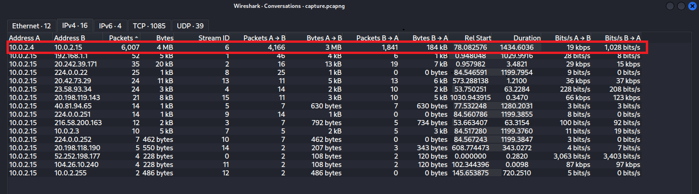
*Figure 2: IPv4 conversations showing the traffic spike between the two hosts.*

**A.2 TCP SYN scan.** Traffic from `10.0.2.4` (source port `55475`) shows rapid SYN-only packets to many destination ports. Closed ports answered `[RST, ACK]`; open ports answered `[SYN, ACK]`. This is consistent with a half-open scan such as `nmap -sS`.

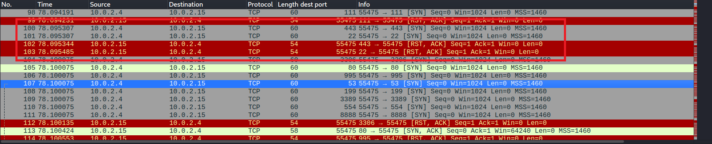
*Figure 3: SYN probes and RST/ACK responses.*

The filter `ip.addr==10.0.2.4 && tcp.flags.syn==1 && tcp.flags.ack==0` returned **1,076 SYN probes**.

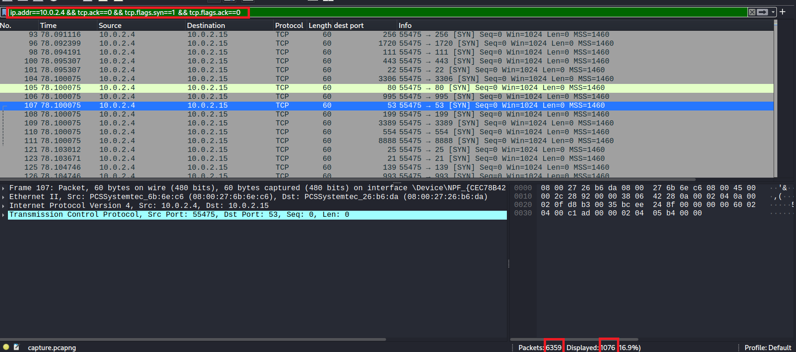
*Figure 4: Filtered view confirming 1,076 probes.*

**A.3 Exposed services.** Filtering for `[SYN, ACK]` from the server shows four open ports:

| Port | Service |
| :--- | :--- |
| 80 | HTTP (Microsoft IIS) |
| 135 | MS-RPC endpoint mapper |
| 139 | NetBIOS session service |
| 445 | SMB |

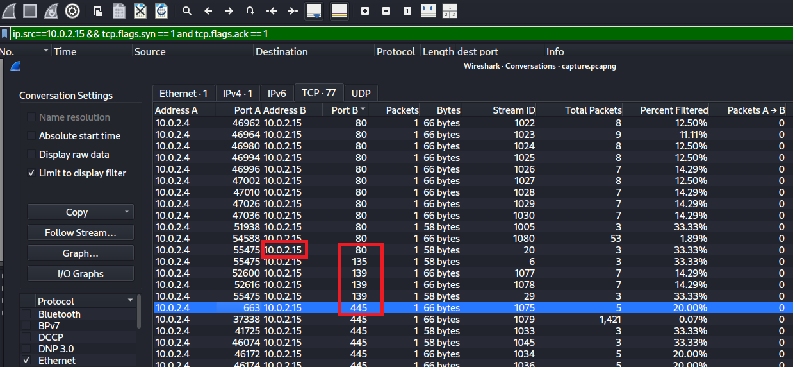
*Figure 5: SYN-ACK responses exposing ports 80, 135, 139 and 445.*

**A.4 HTTP enumeration.** Requests to port 80 carry the header
`User-Agent: Mozilla/5.0 (compatible; Nmap Scripting Engine; https://nmap.org/book/nse.html)`, identifying Nmap NSE.

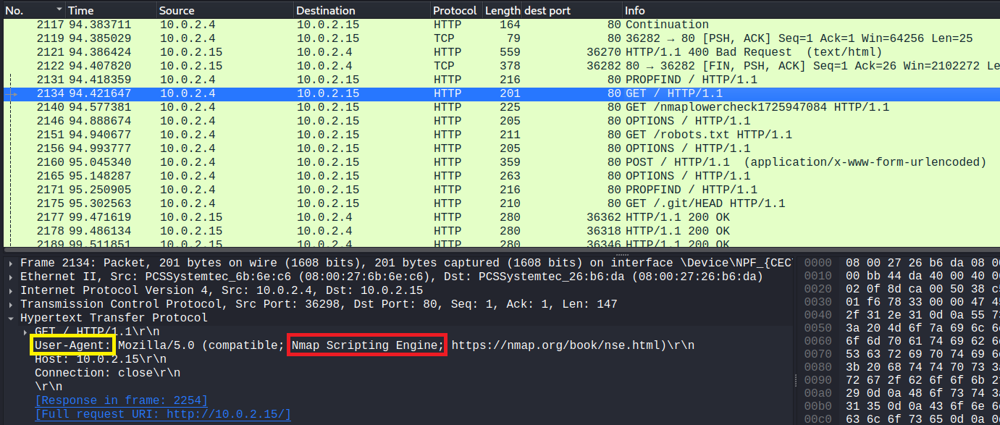
*Figure 6: Nmap Scripting Engine User-Agent in HTTP requests.*

---

### Stage B: SMB Access and Information Disclosure
**ATT&CK:** T1078.003 Valid Accounts: Local Accounts, T1021.002 SMB/Windows Admin Shares, T1039 Data from Network Shared Drive

**B.1 Authentication and share discovery.** The attacker authenticated over SMB2 (NTLMSSP) as **`WORKGROUP\root`** from workstation name `KALI`. A Tree Connect to `\\10.0.2.15\IPC$` was followed by a disconnect and a new connection to `\\10.0.2.15\Documents`, where wildcard queries listed the directory.

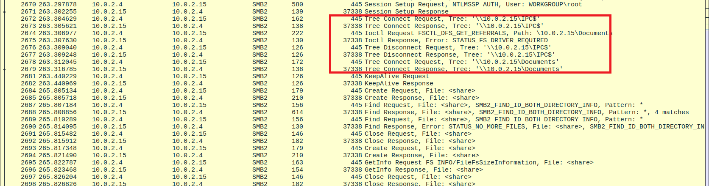
*Figure 7: NTLMSSP authentication, IPC$ tree connect/disconnect and connection to Documents.*

**B.2 File read.** An SMB2 Read Request retrieved `information.txt` (150 bytes).

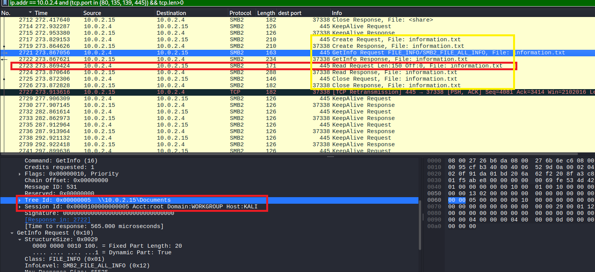
*Figure 8: SMB2 read of `information.txt`.*

Decoded content:

> *"This server setup is under development. We are trying to link the web server with SMB. Please do not tamper with our work. Best regards, Dev Team"*

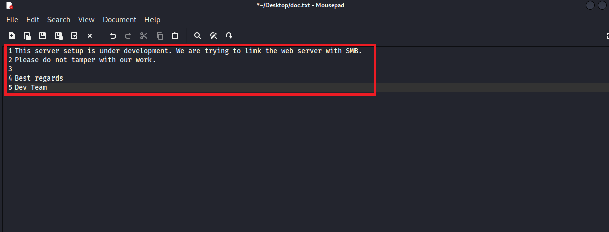
*Figure 9: Reconstructed plaintext of `information.txt`.*

The note indicates that the SMB share is linked to the web server, which the later HTTP request to `/Documents/shell.aspx` confirms.

> **Finding:** The origin of the `root` credential could not be determined from the evidence (see [Limitations](#9-limitations-and-open-questions)).

---

### Stage C: Web Shell Deployment and Reverse Shell
**ATT&CK:** T1505.003 Server Software Component: Web Shell, T1059 Command and Scripting Interpreter, T1571 Non-Standard Port

**C.1 Upload.** The attacker created `shell.aspx` in `\\10.0.2.15\Documents` (SMB2 Create) and sent the file content in an SMB2 Write Request at **05:48:53 UTC (frame #3505)**.

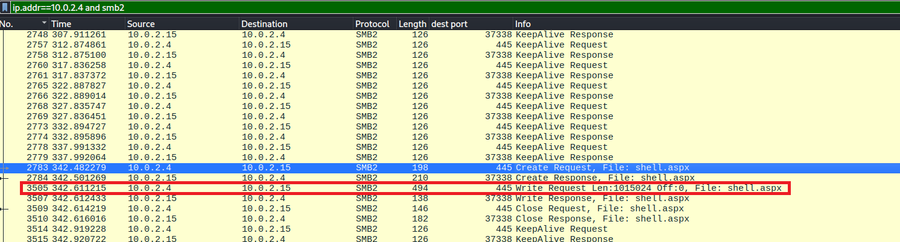
*Figure 10: SMB2 Create and Write of `shell.aspx`.*

**C.2 Trigger and callback.** Review of traffic after frame #3505 shows `GET /Documents/shell.aspx HTTP/1.1` answered with `HTTP/1.1 200 OK`, followed by an outbound TCP connection from `10.0.2.15` to `10.0.2.4` on port **4443**.

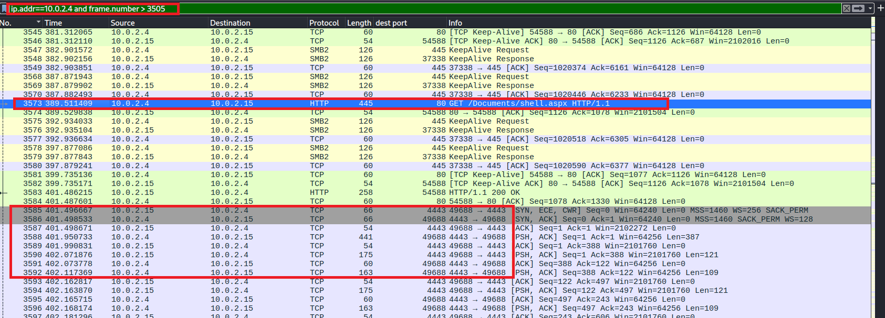
*Figure 11: Web shell request followed by the reverse connection to port 4443.*

> **Analyst note:** The content of `shell.aspx` was ⟨not extracted / extracted via Export Objects > SMB and analyzed: describe findings⟩.

---

### Stage D: Memory Forensics and Persistence
**ATT&CK:** T1547.001 Boot or Logon Autostart Execution: Startup Folder, T1105 Ingress Tool Transfer *(suspected, delivery method unconfirmed)*

**D.1 System baseline.** `windows.info` confirmed a 64-bit Windows Server image (Kernel Base `0xf80079213000`).

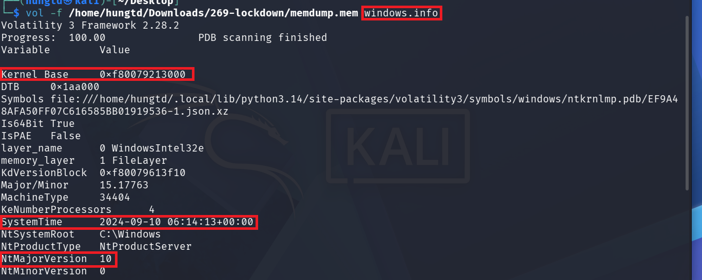
*Figure 12: `windows.info` output.*

**D.2 Process lineage.** `windows.pslist` shows:
- **`w3wp.exe` (PID 4332):** IIS worker process, the context in which an uploaded ASPX page executes.
- **`updatenow.exe` (PID 900):** created at **06:08:23 UTC** with `w3wp.exe` as parent.

An IIS worker process does not normally launch standalone third-party executables. Together with the web shell activity, this indicates the binary was started through the web shell session.

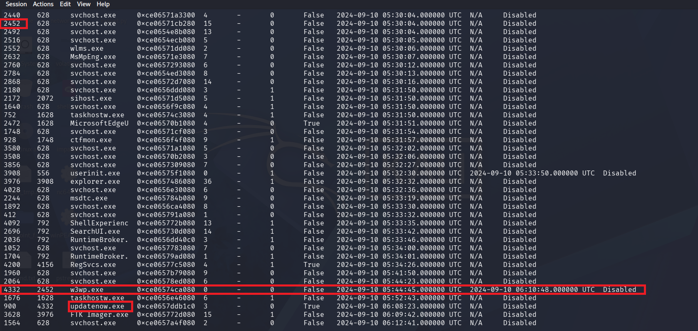
*Figure 13: `w3wp.exe` as parent of `updatenow.exe` (06:08:23 UTC).*

**D.3 Persistence location.** The process command line shows:
`C:\ProgramData\Microsoft\Windows\Start Menu\Programs\Startup\updatenow.exe`
Executables in the All-Users Startup folder run at logon of any user, so this location establishes persistence. Execution after a reboot was not tested.

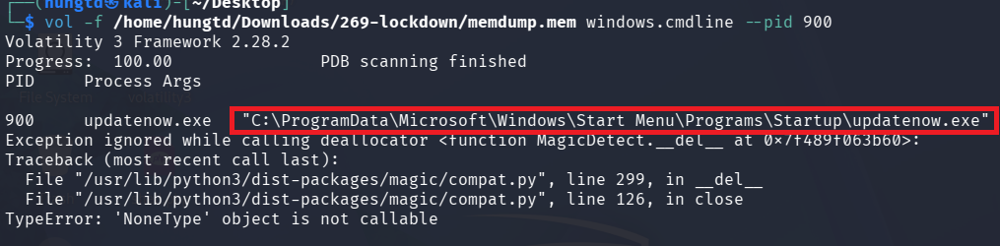
*Figure 14: Command line showing the Startup-folder path.*

---

### Stage E: Malware Triage
**ATT&CK:** T1027.002 Software Packing, T1071 Application Layer Protocol

**E.1 Packer.** `strings` shows `UPX0`, `UPX1`, `.rsrc`, the `UPX!` signature and version `3.91`, so the binary is UPX-packed.

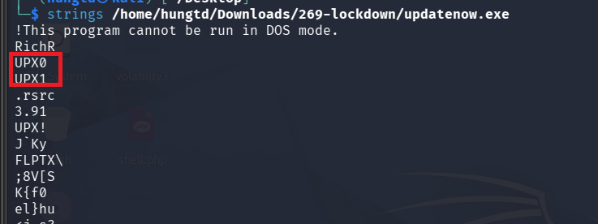
*Figure 15: UPX 3.91 markers in `strings` output.*

**E.2 Manifest.** The embedded manifest requests `level="asInvoker"`. The sample therefore does not request elevation and runs with the invoking token (here, the IIS worker identity) without a UAC prompt. This is not a UAC bypass.

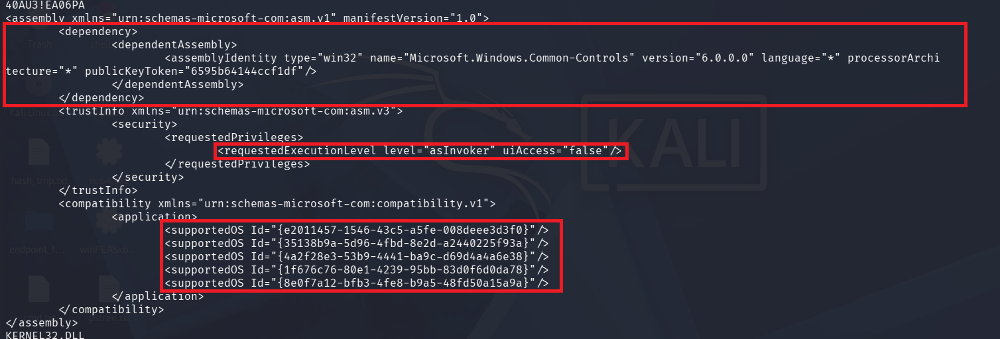
*Figure 16: Embedded manifest with `asInvoker`.*

**E.3 Static metadata and attribution.** VirusTotal details show a 32-bit PE packed with UPX 3.91 and an AutoIt component.

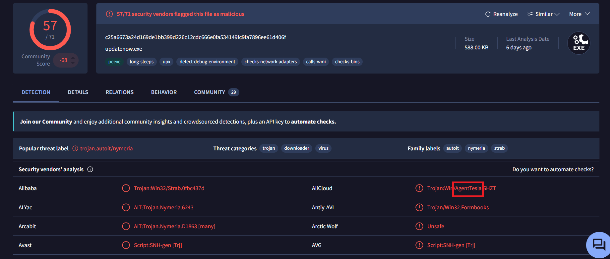
*Figure 17: VirusTotal Details tab (UPX 3.91, AutoIt).*

The sample is detected by **57/71** engines, and vendor labels attribute it to **AgentTesla**, a commodity information stealer and RAT. Attribution here rests on vendor consensus; no configuration extraction or local sandbox run was performed.

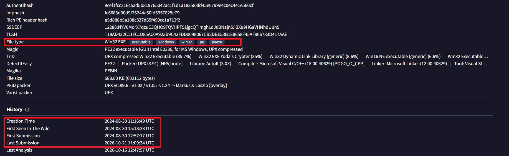
*Figure 18: VirusTotal detections naming AgentTesla.*

**E.4 Network indicator.** VirusTotal sandbox telemetry lists the contacted domain **`cp8nl.hyperhost.ua`**. AgentTesla variants commonly exfiltrate over SMTP, FTP or HTTP, so this domain may represent an exfiltration endpoint rather than a classic C2 server. It was not independently verified.

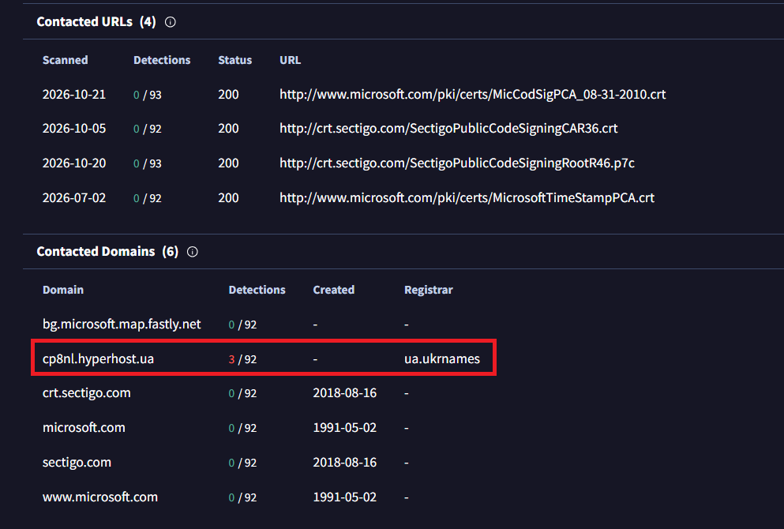
*Figure 19: Domain contacted during sandbox execution.*

---

## 4. Timeline

> All times in UTC. PCAP offsets are Wireshark relative times; UTC values for PCAP events are derived from the anchor point frame #3505 = 05:48:53 UTC (set *View > Time Display Format > UTC Date and Time of Day* to read them directly).

| UTC | PCAP offset | Stage | Source | Event |
| :--- | :--- | :--- | :--- | :--- |
| **05:44:28** | 78.08 s | Reconnaissance | `10.0.2.4` | TCP SYN scan (1,076 probes); open ports 80, 135, 139, 445 identified |
| **05:44:45** | 94.42 s | Reconnaissance | `10.0.2.4` | Nmap NSE HTTP enumeration against port 80 |
| **05:47:34** | 263.29 s | Initial access | `10.0.2.4` | SMB2 login as `WORKGROUP\root`; IPC$ probe; connect to `Documents` |
| **05:47:44** | 273.86 s | Collection | `10.0.2.4` | `information.txt` read over SMB2 |
| **05:48:53** | 342.61 s | Weaponization | `10.0.2.4` | `shell.aspx` written to `\\10.0.2.15\Documents` |
| **05:49:40** | 389.51 s | Execution | `10.0.2.4` | `GET /Documents/shell.aspx` |
| **05:49:52** | 401.49 s | Command and control | `10.0.2.15` | Outbound connection to `10.0.2.4:4443` |
| **06:08:23** | n/a (outside PCAP) | Persistence | `w3wp.exe` (PID 4332) | `updatenow.exe` (PID 900) started from the Startup folder |
| **06:09:42** | n/a | Response | FTK Imager | Memory acquisition (`memdump.mem`) |

---

## 5. MITRE ATT&CK Mapping

| Tactic | Technique | Evidence |
| :--- | :--- | :--- |
| Reconnaissance | T1595 Active Scanning | 1,076 SYN probes; Nmap NSE User-Agent |
| Discovery | T1046 Network Service Discovery | Open-port enumeration; share listing |
| Initial Access / Lateral Movement | T1078.003 Valid Accounts: Local Accounts | SMB login as `WORKGROUP\root` |
| Lateral Movement | T1021.002 SMB/Windows Admin Shares | IPC$ and Documents tree connects |
| Collection | T1039 Data from Network Shared Drive | Read of `information.txt` |
| Persistence | T1505.003 Web Shell | `shell.aspx` in IIS-served directory |
| Execution | T1059 Command and Scripting Interpreter | Shell session through `w3wp.exe` |
| Command and Control | T1571 Non-Standard Port | Reverse connection on TCP/4443 |
| Command and Control | T1105 Ingress Tool Transfer *(suspected)* | `updatenow.exe` on host, transfer method unconfirmed |
| Persistence | T1547.001 Startup Folder | `updatenow.exe` in All-Users Startup |
| Defense Evasion | T1027.002 Software Packing | UPX 3.91 |

---

## 6. Indicators of Compromise

| Type | Value | Source | Notes |
| :--- | :--- | :--- | :--- |
| IPv4 | `10.0.2.4` | PCAP | Attacker host (scan, SMB, reverse shell listener) |
| IPv4 | `10.0.2.15` | PCAP / Memory | Victim IIS server |
| Domain | `cp8nl.hyperhost.ua` | VirusTotal sandbox | Contacted by sample; role unverified |
| SHA-256 | `c25a6673a24d169de1bb399d226c12cdc666e0fa534149fc9fa7896ee61d406f` | Sample | `updatenow.exe` (UPX / AutoIt / AgentTesla per vendors) |
| File path | `\Documents\shell.aspx` | PCAP | Uploaded web shell |
| File path | `C:\ProgramData\Microsoft\Windows\Start Menu\Programs\Startup\updatenow.exe` | Memory | Persistence location |
| Account | `WORKGROUP\root` | PCAP | Account used for SMB access |
| Port | TCP/4443 | PCAP | Reverse shell callback |
| User-Agent | `Mozilla/5.0 (compatible; Nmap Scripting Engine; https://nmap.org/book/nse.html)` | PCAP | Nmap NSE |
| Process | `w3wp.exe` PID 4332 to `updatenow.exe` PID 900 | Memory | Anomalous parent/child |

---

## 7. Detection Engineering

Sigma rules written from the observed behavior. Field names follow Sigma conventions and should be validated against the target backend before deployment.

**Rule 1: IIS worker process spawning child processes**
```yaml
title: IIS Worker Process Spawning Suspicious Child Process
status: experimental
description: Detects w3wp.exe launching shells or non-IIS executables, typical of web shell activity.
logsource:
  category: process_creation
  product: windows
detection:
  selection:
    ParentImage|endswith: '\w3wp.exe'
  filter_legit:
    Image|endswith:
      - '\conhost.exe'
      - '\csc.exe'
      - '\cvtres.exe'
  condition: selection and not filter_legit
falsepositives:
  - Legitimate applications that spawn helper processes (tune per environment)
level: high
tags:
  - attack.persistence
  - attack.t1505.003
  - attack.execution
  - attack.t1059
```

**Rule 2: Executable created in the All-Users Startup folder**
```yaml
title: Executable Written to All-Users Startup Folder
status: experimental
description: Detects creation of executable files in the global Startup folder.
logsource:
  category: file_event
  product: windows
detection:
  selection:
    TargetFilename|contains: '\ProgramData\Microsoft\Windows\Start Menu\Programs\Startup\'
    TargetFilename|endswith:
      - '.exe'
      - '.dll'
      - '.bat'
      - '.ps1'
      - '.vbs'
  condition: selection
falsepositives:
  - Software installers placing shortcuts or helpers (review the writing process)
level: high
tags:
  - attack.persistence
  - attack.t1547.001
```

**Rule 3: Script file created in a web-served directory**
```yaml
title: ASPX File Created in Web Directory
status: experimental
description: Detects creation of .aspx/.asmx files in IIS content paths, including writes made over SMB (written by the System process).
logsource:
  category: file_event
  product: windows
detection:
  selection:
    TargetFilename|endswith:
      - '.aspx'
      - '.asmx'
      - '.ashx'
    TargetFilename|contains:
      - '\inetpub\'
      - '\Documents\'   # adjust to the actual shared/web path
  condition: selection
falsepositives:
  - Planned web application deployments
level: high
tags:
  - attack.persistence
  - attack.t1505.003
```

**Rule 4: Nmap NSE against web server**
```yaml
title: Nmap Scripting Engine User-Agent in Web Requests
status: experimental
description: Detects Nmap NSE enumeration via its default User-Agent.
logsource:
  category: webserver
detection:
  selection:
    cs-user-agent|contains: 'Nmap Scripting Engine'
  condition: selection
falsepositives:
  - Authorized vulnerability scanning
level: medium
tags:
  - attack.reconnaissance
  - attack.t1595
```

### Detection Coverage by Stage

| Stage | Earliest detection opportunity |
| :--- | :--- |
| Scan | Many SYNs from one source to many ports (IDS/firewall threshold); Rule 4 for NSE |
| SMB access | Successful SMB logon (Event ID 4624, logon type 3) by `root` from an unusual host |
| Web shell upload | Rule 3 |
| Web shell execution | Rule 1; outbound connection from `w3wp.exe` to an uncommon port |
| Persistence | Rule 2 |

---

## 8. Recommendations

### Containment and Eradication
1. **Isolate** `10.0.2.15` and block `10.0.2.4` at the perimeter.
2. **Block** `cp8nl.hyperhost.ua` at DNS and egress, and block outbound TCP/4443.
3. **Remove artifacts:** stop `updatenow.exe` (PID 900), recycle the affected application pool, delete the Startup-folder binary and `shell.aspx`. Preserve copies for evidence first.
4. **Rotate credentials** for `root` and all accounts present on the host, since information stealers harvest stored credentials.
5. **Review** the server for additional web shells and scheduled tasks or services created during the intrusion window.

### Hardening
1. **Separate SMB shares from web roots.** Do not map writable shares into IIS content paths; set script execution to *None* on upload directories.
2. **Restrict SMB.** Block TCP 139/445 from untrusted networks; limit administrative access to management hosts.
3. **Credential hygiene.** Disallow a generic `root` account on Windows servers; enforce strong passwords and lockout, and alert on repeated logon failures.
4. **Endpoint controls.** Use EDR or ASR rules to block `w3wp.exe` from spawning interpreters and unsigned binaries.
5. **Logging.** Enable process creation (4688 or Sysmon 1), file creation (Sysmon 11), SMB and IIS logs, and forward them centrally.

---

## 9. Limitations and Open Questions

- **Credential source:** ⟨No brute-force activity observed in the PCAP / observed N failed logons (STATUS_LOGON_FAILURE)⟩; how `root` credentials were obtained is undetermined.
- **Payload delivery:** how `updatenow.exe` reached the host is not confirmed by the evidence. ⟨Update if found.⟩
- **Time gap:** about 19 minutes separate the web shell trigger and the start of `updatenow.exe`. This is consistent with manual operator activity through the shell, but the capture does not cover that interval.
- **Attribution:** AgentTesla attribution comes from vendor labels only; no config extraction or local dynamic analysis was done.
- **Network indicator:** the contacted domain is from third-party sandbox data and its role is unverified.
- **Web shell content:** ⟨state whether `shell.aspx` was analyzed⟩.
- **Scope:** no evidence reviewed for lateral movement or further data theft beyond `information.txt`.

---

## 10. Lessons Learned

- A single misconfiguration (writable share mapped to an executable web path) converted file-share access into remote code execution.
- Process lineage was the most reliable host indicator: a web server worker process launching an executable stands out immediately.
- Separating observed facts from inferences (attribution, C2 role, delivery method) keeps conclusions defensible.

---

## Repository Structure

```
.
├── README.md
├── images/               # Figures referenced in this report
├── detections/           # Sigma rules (rule files)
└── evidence-hashes.txt   # SHA-256 of pcap / memdump / sample
```
